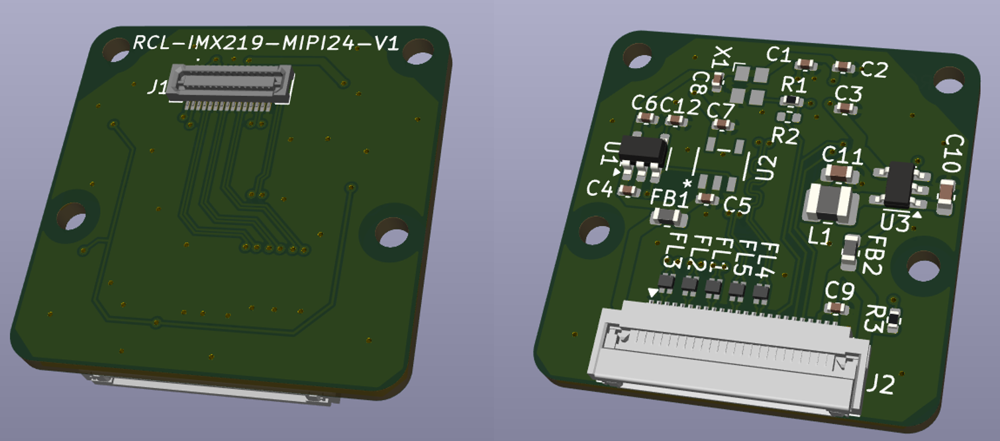
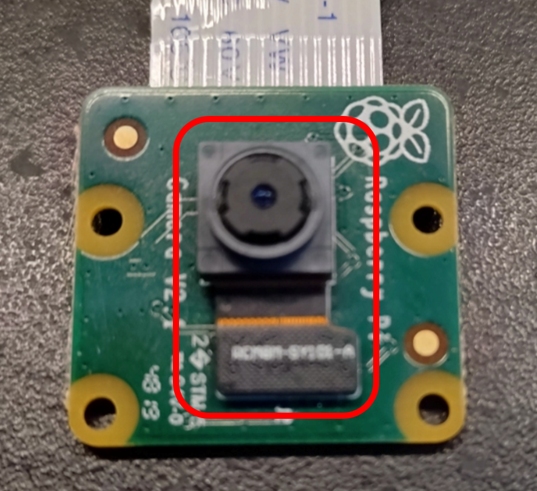
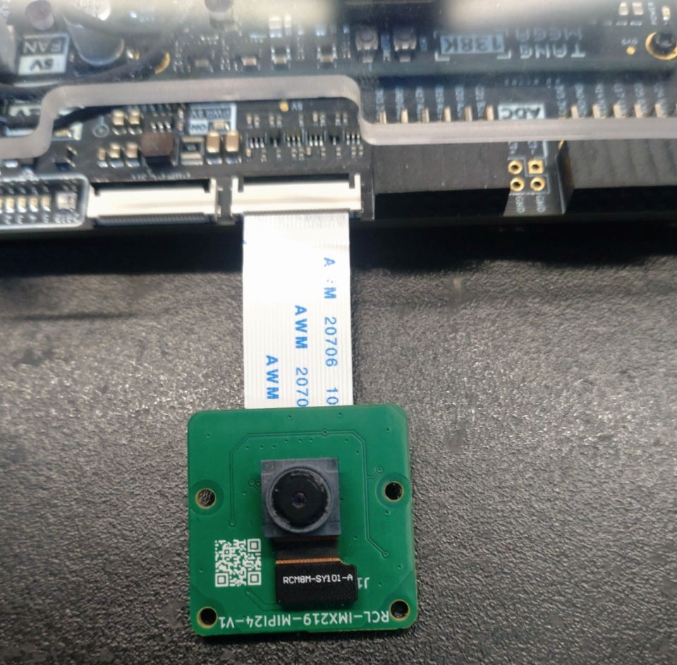
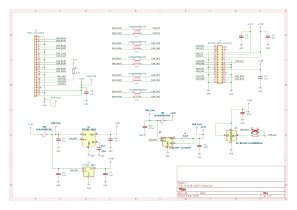
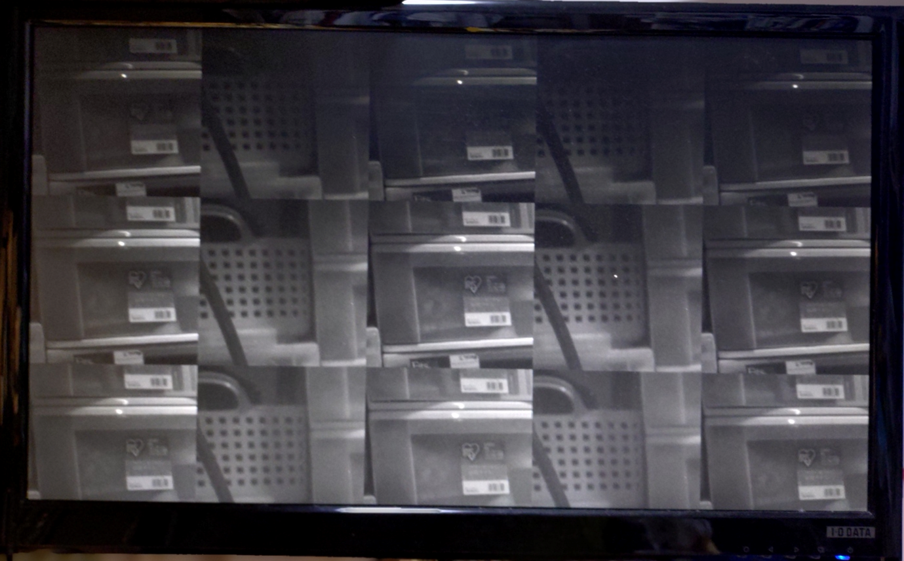

# IMX219 MIPI Adapter Board for Tang Mega 138K Pro Dock

[日本語版はこちら (README.md)](README.md)

## Overview

This is an adapter board which allows you to connect the camera module from the [Raspberry Pi Camera V2](https://raspberry-pi.ksyic.com/main/index/pdp.id/144/pdp.open/144) to the [Tang Mega 138K Pro Dock](https://wiki.sipeed.com/hardware/en/tang/tang-mega-138k/mega-138k-pro.html) by replacing the base board.

It enables the use of Sony's IMX219 sensor with Sipeed's (apparently proprietary) 24-pin MIPI connector.

## Board Images

Here is the adaptor board:

Remove the camera module from the Raspberry Pi Camera V2 board, and attach it to this adapter board for use.

The final assembled board is shown below.

## Data

Here is the schematic. (The PDF version is [here](imx219_mipi24/imx219_mipi24.pdf)):

Designed with [KiCAD](https://www.kicad.org/) version 9.0.0.

Prototypes were manufactured by JLCPCB's PCBA service.  Impedance control is based on the manufacturing specifications for "FR4-Standard TG 135-140" 4-layer boards from [JLCPCB](https://jlcpcb.com/).

Prototyping was also done with JLCPCB's PCBA service. Some components, such as oscillators, may be discontinued parts because they were selected from those in stock at the time. If you manufacture this board yourself, please select alternative or compatible parts as needed.

The cables tested are [05-24-A-0030-A-4-06-4-T](https://www.marutsu.co.jp/pc/i/46064636/) and [05-24-A-0152-A-4-06-4-T](https://www.marutsu.co.jp/pc/i/46064715/).
## Operation Test

Operation tests have been performed with the following projects:

- https://github.com/ryuz/jelly/tree/master/projects/tang_mega_138k_pro/tang_mega_138k_pro_imx219_720p
- https://github.com/ryuz/jelly/tree/master/projects/tang_mega_138k_pro/tang_mega_138k_pro_imx219_stereo

Below is an example where two cameras are connected and 256x256 images are alternately displayed:

Simple reception tests have succeeded with both 2-lane and 4-lane configurations.

## Disclaimer

This design data is intended for use in experimental prototypes for research and development. The author assumes no responsibility for any damages arising from its use.

## License

This design data is provided under the [Creative Commons Attribution-NonCommercial 4.0 International License](https://creativecommons.org/licenses/by-nc/4.0/).

You are free to use this for hobby or research purposes as long as you do not sell or distribute the manufactured boards.
If you wish to manufacture and sell commercially, please contact the author for a separate license agreement.

## BOOTH Sales

For those who find it difficult to manufacture the board themselves, the author has listed a small number of extra boards on [BOOTH](https://rtc-lab.booth.pm/):

- [IMX219 MIPI Adapter Board for Tang Mega 138K Pro Dock](https://rtc-lab.booth.pm/items/7095235)
- [IMX219 MIPI Camera Board for Tang Mega 138K Pro Dock (with image sensor)](https://rtc-lab.booth.pm/items/7132890)

These are prototypes and quality is not guaranteed. They are available only while stocks last.

Boards purchased from the author may be used freely for both commercial and non-commercial purposes.

## Author

Ryuji Fuchikami
[Real-Time Computing Lab](https://rtc-lab.com/)
